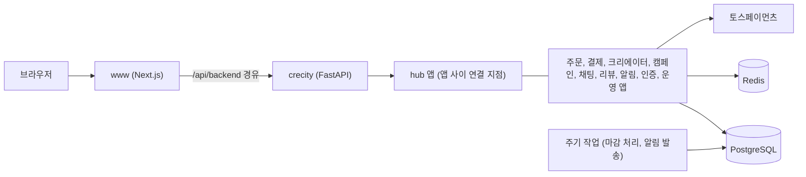

# crecity

광고를 맡기려는 브랜드와 인플루언서, UGC 크리에이터가 중개인 없이 직접 찾고, 주문하고, 대금을 주고받는 마켓플레이스입니다.

상태: 개발 멈춤 (2026-08). 배포하지 않았습니다. 2026-08-13에 "당분간 배포하지 않는다"고 정했고, 배포에 필요한 계약과 설정은 [`_docs/launch-checklist.md`](_docs/launch-checklist.md)에 모아 두었습니다.

해외 서비스 Collabstr를 직접 살펴보고 정리한 분석 문서([`_docs/collabstr-analysis.md`](_docs/collabstr-analysis.md))를 요구사항으로 삼아 설계했습니다. 혼자 Claude Code로 만들었고, 테스트와 실제 서버 점검 스크립트로 결과를 확인했습니다.

## 한눈에 보기

| 항목 | 내용 |
| --- | --- |
| 기간 | 2026-08-10 ~ 2026-08-22 (main 브랜치 첫 커밋과 마지막 커밋 기준, 커밋 126개) |
| 인원과 역할 | 1인. 기획, 요구사항 정리, 백엔드, 프론트엔드, 검증 |
| 상태 | 개발 멈춤 (2026-08), 배포 안 함 |
| 주요 기술 | Python 3.13, FastAPI, SQLAlchemy 2(async), PostgreSQL 17, Redis 7, Next.js 16, React 19, TypeScript, Tailwind 4, 토스페이먼츠 SDK |

## 주요 기능

- 크리에이터는 인스타그램 릴스 1개, 제품 사진 4장처럼 가격을 공개한 상품을 올리고, 브랜드는 여러 크리에이터의 상품을 장바구니에 담아 한 번에 결제합니다.
- 결제한 돈은 플랫폼이 맡아 두었다가, 크리에이터가 결과물을 올리고 브랜드가 승인하면 크리에이터 잔액으로 넘어갑니다. 수락 기한(72시간), 양측 합의 취소, 분쟁 신고와 운영자 판정이 있습니다.
- 브랜드가 캠페인 공고를 올리면 크리에이터가 지원하고, 브랜드가 지원을 수락하면 바로 주문과 결제로 이어집니다.
- 브랜드와 크리에이터는 채팅으로 이야기하고, 주문 상태가 바뀔 때마다 사이트 안 알림을 받습니다.
- 크리에이터는 잔액을 인출할 수 있고, 원천징수 3.3%와 연간 지급 내역이 함께 계산됩니다.
- 운영자는 크리에이터 프로필 심사, 분쟁 판정, 인출 지급 처리, 신고 처리를 운영 콘솔에서 합니다.


## 구조



백엔드는 한 프로세스 안에 10개 앱(`crecity/apps/`)을 두는 구조입니다. 앱끼리는 서로를 직접 부르지 않고 `hub` 앱이 정한 약속(포트)으로만 협력하며, 이 규칙은 `crecity/.importlinter`가 커밋마다 검사합니다. 돈이 한꺼번에 움직여야 하는 변경(주문, 예치, 수수료 기록)은 한 앱 안의 한 트랜잭션으로 묶었고, 그 기준은 [`crecity/_docs/BOUNDARIES.md`](crecity/_docs/BOUNDARIES.md)에 있습니다. 주문 마감 처리, 캠페인 마감 처리, 알림 발송은 `crecity/scripts/`의 주기 작업으로 돕니다.

## AI와 함께 만든 방식

코드는 Claude Code가 작성했고, 저는 무엇을 만들지 정하고 결과를 테스트와 실제 화면으로 확인하는 역할을 맡았습니다.

- **규칙 문서로 에이전트를 묶었습니다.** 루트 `CLAUDE.md`와 영역별 `_docs/CLAUDE.md`(백엔드 1, 프론트엔드 2, 앱별 10)가 있고, 에이전트는 작업 전에 이 문서를 먼저 읽습니다. 예를 들어 "앱끼리 직접 import 금지", "프론트엔드는 절대 URL로 백엔드를 부르지 않음", "응답 스키마에 기본값 금지" 같은 규칙이 여기에 있습니다. 마지막 규칙은 실제 버그를 겪은 뒤 추가한 것입니다(아래 검증의 `50d4eac`).
- **요구사항과 구현을 반복해서 대조했습니다.** 첫 기능 묶음을 만든 뒤 요구사항 문서와 실제 API와 화면 목록을 대조해 빠진 기능을 [`_docs/feature-gaps.md`](_docs/feature-gaps.md)에 번호를 붙여 적었습니다. 이후 요구사항 문서와의 재대조를 2026-08-14(2차)부터 2026-08-21(6차)까지 이어 가며 P0~P11 단계로 백로그를 쌓았고, 매번 대조 각도를 바꿨습니다(예: 6차는 분쟁, 인출, 캠페인 지원자 쪽 흐름을 따라가 갭 #103~105를 찾음). 멈춘 시점에 이 문서에는 완료 체크된 항목이 93개, 남은 항목이 13개 있고, 문서는 남은 항목을 모두 외부 계약이나 실사용자 같은 조건을 기다리는 것으로 분류해 보류했습니다.
- **흐름:** 요구사항 분석 문서에서 갭 백로그 항목을 만들고(근거 조항 번호 포함), 구현한 뒤 pytest, import 규칙, 타입 검사, 실서버 점검을 거쳐, 백로그에 완료 날짜와 검증 결과를 적는 순서로 일했습니다. 커밋 메시지에도 문제, 해결, 설계 판단, 검증을 나눠 적었습니다.
- **커밋:** main의 커밋 126개 중 125개에 Claude 공동 작성자 표시(`Co-Authored-By: Claude`)가 있습니다.
- **사람이 내린 결정은 날짜와 함께 문서에 남겼습니다.** 구독 플랜, 알림톡, 채팅 팀원 초대 보류(2026-08-11), 당분간 배포하지 않음(2026-08-13), 배포보다 기능 완성도를 먼저 올림(2026-08-18) 같은 결정이 `_docs/feature-gaps.md`와 `_docs/launch-checklist.md`에 있습니다. 새로 찾은 갭 묶음도 승인한 뒤에 착수했습니다(P9 "사용자 승인 대기", P10과 P11 "발굴·승인").
- **없는 것을 있는 척하지 않게 했습니다.** 실제 거래 실적이 없으므로 고객 사례와 성과 수치는 만들지 않았고, 아직 없는 기능(팀 워크스페이스 등)을 소개하는 랜딩 페이지도 미뤘습니다(`_docs/feature-gaps.md` #13).

## 검증

CI는 두지 않기로 했고(`CLAUDE.md` 주의사항), 대신 로컬 git 훅과 점검 스크립트를 썼습니다.

| 수단 | 무엇을 보는가 | 명령 |
| --- | --- | --- |
| pytest | 유스케이스와 도메인 규칙(테스트 파일 76개, 마지막 기록 488개 통과, `_docs/feature-gaps.md` #104) | `PYTHONPATH=crecity:crecity/apps .venv/bin/python -m pytest crecity/apps -q` |
| import-linter | 아키텍처 계약 5종(계층 방향, 앱끼리 독립, 프레임워크 격리, 도메인 순수성, 허브 격리) | `cd crecity && PYTHONPATH=apps ../.venv/bin/lint-imports --config .importlinter` |
| 타입 검사 | 프론트엔드 전체(프론트엔드 테스트 러너는 없음) | `cd www && pnpm run typecheck` |
| 스모크 | 실제로 띄운 서버와 DB에 대고 권한, 응답 필드, 돈 기록 정합성 확인(마지막 기록 72건) | `.venv/bin/python scripts/smoke.py [--frontend]` |
| 브라우저 E2E | 로그인한 상태의 실제 화면(마지막 기록 24건) | `.venv/bin/python scripts/e2e.py` |
| 모바일 점검 | 전체 라우트를 375px 폭으로 열어 가로 넘침 확인 | `.venv/bin/python scripts/mobile_sweep.py` |

git 훅은 `scripts/git-hooks/`에 있습니다. 커밋 전에는 import-linter가, push 전에는 pytest 전체가 돌고 실패하면 막습니다.

테스트와 점검이 실제로 잡아낸 문제 몇 가지입니다.

- `50d4eac` 스모크 스크립트가 실패를 잡는지 일부러 응답 필드를 빼 봤는데 처음에는 못 잡았습니다. 응답 스키마의 기본값 때문에 DB에는 "주문 안 받음"인데 화면에는 "주문 받음"으로 나가고 있었습니다. pytest와 타입 검사는 모두 통과하던 오류였고, 기본값을 없애고 규칙으로 남겼습니다.
- `827237f` 카테고리를 늘리며 실서버로 끝까지 확인하다가, 프로필 수정 API가 항상 500 오류를 내던 버그를 찾았습니다. 앞서 조회 쪽만 고치고 수정 쪽은 빠뜨린 것이었고, 회귀 테스트를 추가했습니다.
- `7a05bb9` 로그인이 필요한 화면 15종을 브라우저로 처음 확인하면서, 로그인했는데도 리뷰가 가려진 채로 남는 문제와 채팅방에 들어가면 화면 전체가 밀려 올라가는 문제를 찾았습니다. 둘 다 타입 검사와 스모크로는 보이지 않던 문제입니다.

## 시작하기

필요한 것: Python 3.13, Node.js와 pnpm, Docker.

```bash
# 환경 변수 (예시 값이 로컬 도커 설정과 맞춰져 있음)
cp .env.example .env

# 인프라 (postgres:5433, redis:6380)
docker compose up -d

# 백엔드 설치와 마이그레이션
python3.13 -m venv .venv && .venv/bin/pip install -r crecity/requirements.txt
(cd crecity && PYTHONPATH=apps ../.venv/bin/alembic upgrade head)

# git 훅 연결 (새 클론에서 한 번)
git config core.hooksPath scripts/git-hooks

# 백엔드 실행 http://127.0.0.1:8000 (API 문서는 /docs)
cd crecity && ../.venv/bin/uvicorn main:app --reload

# 프론트엔드 실행 http://localhost:3000 (다른 터미널, 저장소 루트에서)
cd www && pnpm install && pnpm run dev
```

테스트 명령은 위 검증 표에 있습니다. 개발용 토큰 발급, 데모 데이터 같은 나머지 명령은 `CLAUDE.md`의 "명령어" 절에 있습니다.

## 폴더 구조

| 경로 | 내용 |
| --- | --- |
| `crecity/apps/` | 백엔드 앱 10개 (hub, auth, creator, order, payment, campaign, chat, review, notification, admin) |
| `crecity/core/` | DB 세션, Redis, 설정값 읽기 |
| `crecity/alembic/` | DB 마이그레이션 |
| `crecity/scripts/` | 주기 작업, 개발용 토큰 발급, 데모 데이터, systemd 유닛 |
| `www/` | Next.js 프론트엔드 |
| `scripts/` | 스모크, E2E, 모바일 점검, git 훅 |
| `_docs/` | 요구사항 분석, 갭 백로그, 배포 체크리스트 |

## 문서

- [`_docs/collabstr-analysis.md`](_docs/collabstr-analysis.md) 요구사항 분석 (주문 상태, 수수료, 예치 정책 포함)
- [`_docs/feature-gaps.md`](_docs/feature-gaps.md) 요구사항 대조로 만든 기능 갭 백로그와 완료 기록
- [`_docs/launch-checklist.md`](_docs/launch-checklist.md) 배포를 결정할 때 할 일
- [`crecity/_docs/BOUNDARIES.md`](crecity/_docs/BOUNDARIES.md) 앱 경계와 트랜잭션 경계
- [`CLAUDE.md`](CLAUDE.md) 개발 규칙과 명령어 (영역별 규칙은 [`crecity/_docs/CLAUDE.md`](crecity/_docs/CLAUDE.md), [`www/_docs/CLAUDE.md`](www/_docs/CLAUDE.md))
